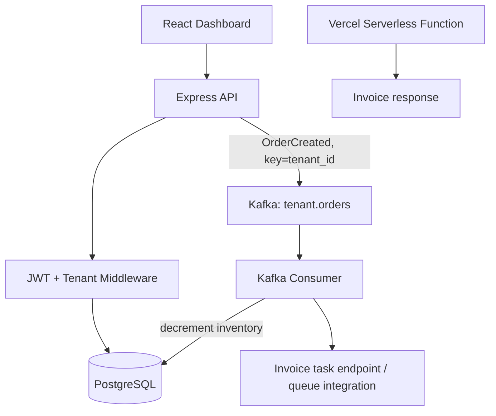

# CSC337 Lab Assignment 06 — Multi-Tenant Order Management SaaS

A learning/reference implementation for database performance tuning, multi-tenancy,
Kafka event processing, and a serverless invoice worker.

> This is a runnable starter project, not a production-certified system. Configure secrets,
> deploy services, run the tests, and capture your own benchmark screenshots before submission.

## Stack
- Frontend: React + Vite
- API: Node.js + Express (ES modules)
- Database: PostgreSQL + `pg` connection pool
- Authentication: JWT
- Events: KafkaJS (local Redpanda or hosted Kafka)
- Async worker: Kafka consumer
- Serverless: Vercel function example

## Architecture



## 1. Requirements
- Node.js 20+
- Docker Desktop (for local PostgreSQL and Redpanda)
- npm

## 2. Start infrastructure

```bash
docker compose up -d
```

This starts PostgreSQL on `localhost:5432` and Redpanda Kafka on `localhost:9092`.
Create a local environment file:

```bash
cp .env.example .env
```

On Windows PowerShell, use `Copy-Item .env.example .env`.

## 3. Install and initialize

```bash
npm install
npm run db:init
```

The initialization script runs `database/schema.sql` and seeds two demo tenants,
users, and inventory items. Demo passwords are for local development only.

## 4. Run the API, consumer, and frontend

In separate terminals:

```bash
npm run dev:api
npm run dev:consumer
npm run dev:web
```

Frontend: http://localhost:5173  
API health: http://localhost:4000/health

## 5. Demo accounts

| Tenant | Email | Password |
|---|---|---|
| ABC Electronics (Tenant A) | `admin@abc.test` | `DemoPass123!` |
| XYZ Fashion (Tenant B) | `admin@xyz.test` | `DemoPass123!` |

The login API issues a signed JWT containing `tenant_id`. The browser sends that token
as a Bearer token. The API derives tenant scope from the verified JWT, not from a
client-supplied tenant header. Do not allow users to select arbitrary tenant IDs.

## 6. API quick test

Login:

```bash
curl -X POST http://localhost:4000/api/v1/auth/login \
  -H "Content-Type: application/json" \
  -d '{"email":"admin@abc.test","password":"DemoPass123!"}'
```

Copy `token` from the response, then create an order:

```bash
curl -X POST http://localhost:4000/api/v1/orders \
  -H "Content-Type: application/json" \
  -H "Authorization: Bearer YOUR_TOKEN" \
  -d '{"items":[{"productId":"REPLACE_WITH_PRODUCT_UUID","quantity":2}]}'
```

A successful request returns **202 Accepted** after the event is published to Kafka.
The consumer validates the tenant and order, decrements inventory in a DB transaction,
and logs the consumed partition and offset. For simplicity, the consumer processes each
order item in a transaction and records processed events to prevent duplicate handling.

List orders:

```bash
curl http://localhost:4000/api/v1/orders -H "Authorization: Bearer YOUR_TOKEN"
```

## 7. Tenant isolation

- The API gets `tenant_id` from the authenticated JWT.
- Every tenant-owned SQL query includes `tenant_id = $1`.
- Orders and products have tenant-aware foreign keys.
- `database/schema.sql` enables PostgreSQL Row-Level Security (RLS) as defense in depth.
- The API sets `app.tenant_id` transaction-locally for tenant-scoped transactions.

Never trust `x-tenant-id` from an unauthenticated request. For a real SaaS product,
add tenant provisioning, refresh-token rotation, rate limiting, audit logging, and
security review.


## 8. Database Performance Tuning

This project demonstrates the N+1 query problem and its optimized JOIN solution.

### N+1 Query Results
- Orders retrieved: 4
- SQL queries executed: 5
- Execution time: 9.65 ms

### Optimized JOIN Results
- Orders retrieved: 4
- SQL queries executed: 1
- Execution time: 1.40 ms

### Performance Comparison

| Metric | N+1 Query | Optimized JOIN |
|---|---:|---:|
| SQL Queries | 5 | 1 |
| Execution Time | 9.65 ms | 1.40 ms |
| Orders Retrieved | 4 | 4 |

The optimized JOIN reduced measured execution time by approximately 85.5% in this test.

### API Endpoints

- GET `/api/v1/performance/n-plus-one`
- GET `/api/v1/performance/optimized`

Both endpoints require JWT authentication.

### Composite Index

```sql
CREATE INDEX IF NOT EXISTS idx_orders_tenant_created
ON orders (tenant_id, created_at DESC);
```


## 9. Connection pooling

The API uses `pg.Pool`. Configure `DATABASE_URL`, `DB_POOL_MAX`,
`DB_IDLE_TIMEOUT_MS`, and `DB_CONNECTION_TIMEOUT_MS` in `.env`.

## 10. Kafka configuration

Local development uses Redpanda without authentication. For Upstash or Aiven, set
`KAFKA_BROKERS`, `KAFKA_USERNAME`, `KAFKA_PASSWORD`, and `KAFKA_SSL=true`.
The producer uses `tenant_id` as the Kafka message key so events for one tenant map
to the same partition (ordering is per partition, not a global ordering guarantee).

Create the topic if your hosted provider requires manual topic creation:
`tenant.orders`.

## 11. Serverless worker

`api/invoice.js` is a Vercel serverless function example. It accepts a POST request
with a valid `INVOICE_WORKER_SECRET` bearer token and returns a generated invoice
summary. Replace the placeholder response with a PDF provider or object-storage
integration before production use.

Measure cold/warm behavior by invoking the deployed function multiple times and
recording timestamps/durations from logs. The first request is not guaranteed to be
a cold start; serverless platforms decide instance reuse. Record observed results,
not assumptions.

## 12. Deployment checklist

- [ ] Create managed PostgreSQL and run `database/schema.sql`.
- [ ] Create hosted Kafka topic `tenant.orders`.
- [ ] Deploy API to Render/Railway with production environment variables.
- [ ] Deploy frontend to Vercel and set `VITE_API_URL`.
- [ ] Deploy `api/invoice.js` to Vercel with `INVOICE_WORKER_SECRET`.
- [ ] Use HTTPS and strong unique secrets.
- [ ] Restrict CORS to the deployed frontend origin.
- [ ] Remove demo accounts and seed credentials.
- [ ] Test Tenant A cannot read Tenant B orders/products.
- [ ] Capture actual EXPLAIN ANALYZE outputs and serverless latency logs.

## Project structure

```text
csc337-multitenant-saas/
├── api/                    # Vercel serverless function
├── backend/
│   ├── src/
│   │   ├── config/         # PostgreSQL pool and Kafka
│   │   ├── middleware/     # JWT and tenant context
│   │   ├── routes/          # Auth and orders
│   │   ├── services/        # Order event publishing
│   │   ├── consumer.js      # Kafka background consumer
│   │   └── server.js        # Express API
├── database/               # Schema, seed, benchmark SQL
├── frontend/               # React dashboard
├── docker-compose.yml
└── .env.example
```
